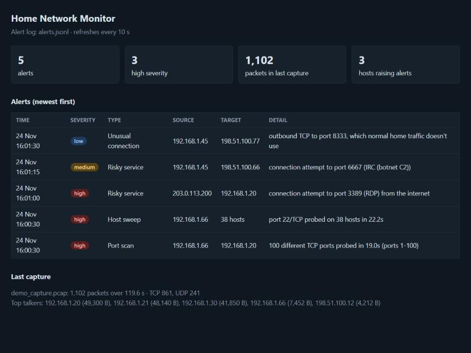

# Home Network Security Monitor

A Python tool I'm building for my home lab. It analyses network traffic, **flags suspicious activity** such as port scans, host sweeps and unusual connections, and logs the alerts to a **simple web dashboard**. The aim is to learn what attacks look like from the defender's side: what a port scan actually looks like in the packets, and why some connections should worry you.

> **Status: early version, in progress (November 2026).** It works on saved packet captures (`.pcap`) for now. Live capture is the next step. See [What's next](#whats-next).



## What it detects

| Alert | Rule | Severity |
|---|---|---|
| **Port scan** | One host tries 15 or more different ports on another host within 10 s | High |
| **Host sweep** | One host tries the same port on 10 or more hosts within 30 s. DNS, NTP and discovery traffic are excluded because they fan out normally. | High |
| **Risky service** | A connection attempt to a port attackers commonly abuse: Telnet, SMB, RDP, VNC, IRC or well-known backdoor ports | High if it comes in from the internet, medium otherwise |
| **Unusual connection** | A device on the home network starts talking to the internet on a port that normal home traffic (web, DNS, mail, NTP, video calls) doesn't use | Low |

- **Connection attempts only:** the rules only look at TCP SYNs without an ACK and at UDP datagrams, so replies and existing connections don't count as probes.
- **One alert per event:** a scan raises one alert, which updates as the scan continues. A scan that happens to hit Telnet doesn't raise a second Telnet alert.

## Try it

You need Python 3.10 or newer and nothing to install, because it only uses the standard library.

```
python -m netmon demo                               # writes demo/demo_capture.pcap
python -m netmon analyse demo/demo_capture.pcap     # prints alerts, appends to logs/alerts.jsonl
python -m netmon dashboard                          # http://127.0.0.1:8050
```

**The demo capture** is synthetic. It has 2 minutes of normal home traffic (DNS, HTTPS, NTP) with four attacks mixed in:
1. a compromised device port-scans a laptop
2. the same device sweeps the network for SSH
3. someone on the internet tries RDP on the laptop
4. a "smart plug" contacts an IRC server and an unusual port

The monitor finds all four and nothing else:

```
1,102 packets over 119.6 s (TCP 861, UDP 241)
[HIGH  ] Port scan          192.168.1.66 -> 192.168.1.20: 100 different TCP ports probed in 19.0s (ports 1-100)
[HIGH  ] Host sweep         192.168.1.66 -> 38 hosts: port 22/TCP probed on 38 hosts in 22.2s
[HIGH  ] Risky service      203.0.113.200 -> 192.168.1.20: connection attempt to port 3389 (RDP) from the internet
[MEDIUM] Risky service      192.168.1.45 -> 198.51.100.66: connection attempt to port 6667 (IRC (botnet C2))
[LOW   ] Unusual connection 192.168.1.45 -> 198.51.100.77: outbound TCP to port 8333, which normal home traffic doesn't use
```

**Your own traffic:** capture it with Wireshark or tcpdump, save it as a classic **pcap**, not pcapng, and run `analyse` on it. Only capture traffic on networks you own or have permission to monitor.

**Tests:** `python -m unittest discover tests -v`

## How it's built

| Path | What it is |
|---|---|
| `netmon/pcap.py` | A pcap reader written from the file-format spec. It handles both byte orders, micro- and nanosecond timestamps, Ethernet with VLAN tags, raw IP and Linux cooked captures, and decodes IPv4 TCP, UDP and ICMP headers, including IP options. It can also write pcaps, which the demo and the tests use. |
| `netmon/detect.py` | The four detectors. Each keeps a sliding time window per source, using a `deque`. |
| `netmon/dashboard.py` | Dashboard built on `http.server`, with a JSON endpoint at `/api/alerts`. It only listens on localhost and HTML-escapes everything taken from packets. |
| `netmon/demo.py` | Generates the synthetic capture. The "internet" addresses come from the documentation ranges, so none of them are real. |
| `tests/` | Parser tests (round trip, byte order, IP options, pcapng rejection), a test for each detector including normal traffic that mustn't trigger it, and an end-to-end check on the demo capture. |

Alerts are stored as JSON lines in `logs/alerts.jsonl`, which git ignores because it describes your own network.

## What's next

- [ ] Live capture (with scapy and Npcap/libpcap) feeding the same detectors
- [ ] pcapng support
- [ ] A per-device baseline, so "unusual" means unusual for that device rather than a fixed port list
- [ ] DNS analysis: newly seen domains and lookups that look algorithmically generated
- [ ] Detecting ARP spoofing on the local network

---

Built with help from Claude Code (AI-assisted development) while I learn network security.
